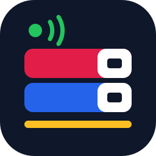
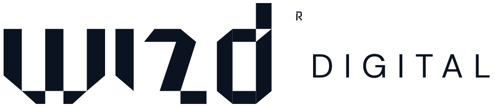

<p align="center">
  <picture>
    <!-- dark theme: light badge; light theme: dark badge -->
    <source media="(prefers-color-scheme: dark)" srcset="assets/brand/cbw-live-light.svg">
    
  </picture>
</p>

# cbw-live

[Português](README.md) · **English**

Live broadcast graphics for the **CBW (Brazilian Wrestling Confederation)**, integrated with **UWW Arena** and **UWW Timing**: scoreboard, clock, fight introduction, challenge, injury/blood time, passivity and victory, ready for OBS, vMix or any browser. It is an in-house alternative to the UWW LGTV.

> Open source project (Apache-2.0), created for the CBW with its approval. **Not affiliated with, endorsed by, or sponsored by UWW.** CBW, UWW and Wizd Digital are trademarks of their respective owners; see [License and credits](#license-and-credits).

```
 UWW Timing (Windows PC at each mat)               server (Mac/Windows/Linux)
 ┌───────────────────────────┐                ┌──────────────────────────────────────────────┐
 │ table: points, time,      │─credentials───▶│ Arena (Docker :8080)                         │
 │ challenge, blood, …       │                │   │ REST/OAuth · webhooks · Mercure (SSE)    │
 │ :9696 "UWW TV Scoreboard" │◀── WebSocket ──│ cbw-live (:8095) ──────────────▶ overlays    │
 └───────────────────────────┘    (listens)   └──────────────────────────────── (OBS, vMix,  │
                                                                                 browser)
```

- **Live scoreboard** in the style of UWW broadcasts: flag, name, country, points, cautions, time, round and category.
- **Expanded and collapsed:** the name leaves the screen while the clock runs and returns on stoppages.
- **Direct connection to UWW Timing** (port 9696, the same as the "UWW TV Scoreboard" screen): everything the table does becomes graphics automatically, including the fight introduction, clock pause, every challenge stage (requested, under review, won, lost, canceled), blood time, passivity and the victory with the official type.
- **Nothing to install on the broadcast and operator machines:** cbw-live runs on the server; OBS, vMix and browsers just open a link.
- **Control page** so the operator can correct or force any graphic (fallback if Timing goes down).
- **National and international events:** flags for the 27 Brazilian states (the same as UWW Timing) and for countries, embedded in the executable (no Arena needed).
- **Fixed URL per mat:** `/overlay.html?mat=A` follows the mat even when the event changes during the day.
- **Transparent background or chroma key** (green/blue).
- **Light and fast:** a single Go executable (~10 MB, no runtime), republishes each update in ~3 ms and distributes through the Mercure that already runs in Arena.

---

## Table of contents
- [How it works](#how-it-works)
- [Requirements](#requirements)
- [Operating systems](#operating-systems)
- [Installation](#installation)
- [Usage](#usage)
- [Screens](#screens)
- [Settings](#settings)
- [Using it in OBS](#using-it-in-obs)
- [Using it in vMix](#using-it-in-vmix)
- [Using it on the web](#using-it-on-the-web)
- [Refresh (reloading the overlays)](#refresh-reloading-the-overlays)
- [What is automatic and what is manual](#what-is-automatic-and-what-is-manual)
- [Network and addresses](#network-and-addresses)
- [Troubleshooting](#troubleshooting)
- [Development](#development)
- [Security](#security)
- [Known limitations and next steps](#known-limitations-and-next-steps)
- [Contributing](#contributing)
- [License and credits](#license-and-credits)

---

## How it works

| Source | What it provides | How cbw-live receives it |
|---|---|---|
| **UWW Timing** (table), **direct connection**: main source | Fight loaded/ready, clock with start/pause, points, cautions, last to score, every challenge stage, blood, passivity, victory, break | WebSocket `ws://<timing-pc>:9696/ws` (the "UWW TV Scoreboard" server Timing already opens) |
| **UWW Timing** via Mercure: fallback | Points, cautions, time, `advantage`, fight state, winner | Subscribes to `http://arena.uww.org/live/{event}/{mat}`, where Timing publishes; used when the direct connection is not active |
| **UWW Arena** (REST) | Events, mats, current fight, full names, flags, category, round, durations, victory types, challenge details | API `/api/json/scoreboard/*` with OAuth (`grant_type=https://arena.uww.io/grants/api_key`) |
| **UWW Arena** (webhooks) | Change notices (`Fight`, `RefereeChallenge`, `RoundTechnicalPoint`, …) | `POST /webhook/arena` |
| **Operator** | Corrections and fallback | Control page |

cbw-live keeps each mat's state in memory and publishes it to Mercure on the topic `cbw/live/{event}/{mat}`. The overlays subscribe through the service's own `/hub` proxy, on the same origin, with the JWT kept on the server.

The scoreboard does not query Arena during a fight. A safety resync runs every 15 s.

**Which Timing belongs to which mat?** It is discovered automatically: when a fight is loaded, Timing reports the event and mat. If cbw-live (re)connects in the middle of a fight, the mat is identified by the athletes' names. You only need to provide the **IP of each Timing PC** (`TIMING_ADDRS`).

## Requirements

- **UWW Arena** running in Docker (official `docker-compose` install), reachable at `http://<ip>:8080`.
- **macOS, Windows or Linux**, see [Operating systems](#operating-systems).
- **Go** (the version in `go.mod`), only if you build it yourself. Ready-made executables are on [Releases](https://github.com/CBW-Wrestling/cbw-live/releases). On macOS: `brew install go`.
- **UWW Timing** (Windows) on the same network, to run the fights.
- OBS Studio, vMix or a modern browser to display the overlays.

## Operating systems

| System | Executable | Status |
|---|---|---|
| macOS (Apple Silicon and Intel) | `cbw-live_*_darwin_*.tar.gz` | Tested by the maintainer |
| Windows 10/11 (64-bit) | `cbw-live_*_windows_amd64.zip` | Built and tested in CI; not yet manually tested at an event. Feedback is welcome |
| Linux (amd64 and arm64) | `cbw-live_*_linux_*.tar.gz` | Built and tested in CI; not yet manually tested at an event. Feedback is welcome |

The code uses only the Go standard library and behaves the same on all three. What changes is the environment:

- **Windows:** open port **8095** in Windows Firewall if OBS/vMix run on another machine. Use PowerShell or Command Prompt for the commands below (`.\cbwlive.exe`). If Arena runs on Docker Desktop on the same machine, `host.docker.internal` works as on macOS.
- **Linux:** Docker does not resolve `host.docker.internal` by itself. Use the machine's IP (e.g. `http://192.168.0.7:8095/webhook/arena`) or add `--add-host=host.docker.internal:host-gateway` to the Arena container.
- **macOS:** `host.docker.internal` works out of the box on Docker Desktop.
- On any system, cbw-live can run on the same machine as Arena or on another one on the network.

## Installation

### 1. Arena credentials
In Arena (`http://<ip>:8080`), logged in as administrator:

1. **Settings → Users → Add a new user**: username `cbwlive`, role **SCOREBOARD**. Then click **(Re)generate API key**.
2. **Settings → Apps → Add a new app**: name `CBW Live`, *Redirect uris* `http://localhost:8080` (the field is required but not used), *Allowed grant types* `https://arena.uww.io/grants/api_key`.

> Do not reuse the **Scoreboard** app, which belongs to UWW Timing. With separate credentials, changing one does not break the other.

### 2. Get the executable
Download the file for your system from [Releases](https://github.com/CBW-Wrestling/cbw-live/releases) and extract it. Or build it (requires Go):

```bash
git clone https://github.com/CBW-Wrestling/cbw-live.git
cd cbw-live
go build -o bin/cbwlive ./cmd/cbwlive
```
For another system, build with `GOOS`/`GOARCH` (e.g. `GOOS=windows GOARCH=amd64 go build -o bin/cbwlive.exe ./cmd/cbwlive`).

### 3. Configuration (`.env`) and running
On any system:
```bash
./cbwlive setup                   # Windows: .\cbwlive.exe setup
```
The wizard asks for the Arena URL, the App ID and Secret of the **CBW Live** app, the API Key of the **cbwlive** user and the IPs of the UWW Timing PCs (optional; see step 6). Secrets are not echoed to the screen. It reads the Mercure key from Arena's `caddy` container when Docker is available (`-arena-dir <docker-compose folder>`) and asks for it otherwise. The `.env` is created with permission 600 (Unix) and never goes into git. Template: [`.env.example`](.env.example). On macOS/Linux, `./scripts/setup-env.sh` remains as a shortcut.

Then:
```bash
./cbwlive                         # uses ./.env; -debug for verbose logs (Windows: .\cbwlive.exe)
```
Open **http://localhost:8095**.

### 4. Webhook in Arena
**Settings → Webhooks → Add a new Webhook**:
- **Url:** `http://host.docker.internal:8095/webhook/arena` (Arena in Docker on the same machine) or `http://<cbw-live-ip>:8095/webhook/arena`
- **Token:** the `WEBHOOK_TOKEN` from `.env` (optional for now; see [Security](#security))
- **Status:** Enabled
- **Events (insert/update/delete):** Fight, FightMat, Fighter, RefereeChallenge, Round, RoundCaution, RoundTechnicalPoint, SportEventMat

### 5. UWW Timing
In Timing (Windows), configure Arena with the **Arena machine's IP** (not `localhost`) and the credentials of the **Scoreboard** app/user. Select the event and mat as usual.

| Program | App (Settings → Apps) | User / API Key (Settings → Users) |
|---|---|---|
| UWW Timing (all PCs) | **Scoreboard** | **scoreboard** |
| cbw-live | **CBW Live** | **cbwlive** |

> Use the **scoreboard** user (SCOREBOARD role) in Timing: with credentials of another role it writes to Arena but stops publishing to Mercure (the fallback channel).

### 6. Direct connection to UWW Timing
**Nothing needs to be configured in Timing.** While it is open, the "UWW TV Scoreboard" server listens on port **9696** (the Timing installer already opens this port in Windows Firewall; in `C:\Program Files\UWWtiming\appsettings.json`, keep `"IpBind": ""`). It does not use App ID, Secret or API Key.

In cbw-live's `.env`, list the Timing PCs (`setup` also asks for them):
```
TIMING_ADDRS=192.168.0.11,192.168.0.12,192.168.0.13
```
Port 9696 is assumed when omitted. In the mat list (`/`), the **UWW Timing direct** column shows which PC is connected to each mat.

Quick check that Timing is reachable: open `http://<timing-ip>:9696/` in a browser; the "UWW TV Scoreboard" screen should appear.

## Usage

1. Start Arena and cbw-live.
2. Open **http://<ip>:8095**: the list shows all events and mats, with the **overlay** and **control** links.
3. Put each mat's **overlay** link in OBS/vMix ([below](#using-it-in-obs)).
4. Open the mat's **control** page for the operator.
5. Run the fights in UWW Timing. Scoreboard, introduction, challenge, blood, passivity and victory follow on their own.

New events and mats created in Arena show up automatically: on each webhook or, at most, within 15 s.

## Screens

| Screen | URL | Purpose |
|---|---|---|
| **Mat list** | `/` | All events and mats, live scoreboard status, overlay and control links |
| **Overlay** | `/overlay.html?mat=<mat>` | The broadcast graphic (1920×1080). This is the OBS/vMix source |
| **Operator control** | `/control.html?event=<id>&mat=<mat>` | Buttons for the manual graphics + live overlay preview |
| **Settings** | `/settings.html` | Global preferences (apply to all mats) |
| **State gallery** | `/preview.html` | Every overlay state with fake data, to review the look without Arena or Timing |

### Overlay
- **Scoreboard** (top left corner): organization logo, round, flag, name, caution cards, country, points, category (`Seniors | FS | 57`), period and clock.
  - White outline on the points box of **whoever scored last** when the score is tied.
  - Clock **pulsing red in the final 10 seconds**.
  - **Expanded/collapsed:** collapsed shows only flag, country, points and time.
- **Side panel:** challenge (requested / under review / won / lost / canceled) and winner ("Winner · VICTORY BY FALL").
- **Side box:** passivity (30 s count) or injury/blood time (4:00, blinking in the last 30 s). With Timing connected directly, it shows Timing's own time and stops together with the pause.
- **Fight introduction** (lower third): flags, countries, full names, "Freestyle - Seniors - 57 kg  Qualification" and "EVENT | City". The scoreboard stays hidden while it is on air.
- URL options: `&debug=1` shows the raw data; `&bg=green|blue|transparent` forces the background of that overlay.

### Operator control
- **Scoreboard on this mat:** Default (follows the settings), Expanded or Collapsed.
- **Introduction:** Show / Hide (shortcut **I**).
- **Challenge:** Red requested / Blue requested → Under review → Won / Lost / Canceled → Hide.
- **Injury/blood time:** Red/Blue × Blood/Injury, and End.
- **Passivity:** Red / Blue, and End.
- **Victory:** victory type (official Arena list) + Red/Blue won.
- **Clear all graphics** (shortcut **Esc**).
- Each section shows what is on air. Several operators or tabs stay in sync.
- When a new fight is loaded in Timing, the previous fight's graphics leave on their own.

### State gallery
Scoreboard (before the fight, running, stopped, tie, cautions, final 10 s, scoring, expand/collapse), challenge (each status and the full flow), time (passivity, blood, injury), result, introduction (international/national) and variations (states, long names). Each scene has **↻ animate** and **full screen**. A single scene opens at `/overlay.html?mock=<scene>`, and you can pick the background (mat, dark, light, checkerboard).

## Settings

### Settings screen (`/settings.html`)
Saved in `data/settings.json` and applied instantly to all open overlays, without reloading.

| Option | Values | Default |
|---|---|---|
| Scoreboard style | Classic CBW · Blue band · Cyan stack · Double block · Purple league · Green band · Arena · Light card · Duel · Dark double · Double bar · Board · UWW official | Classic CBW |
| Scoreboard position | top or bottom × start, center or end (6 positions) | top · start |
| Introduction style | Lower third · Versus · Center card · Top bar · Arena · Light card · Split screen · Thin band · UWW official | Lower third |
| Introduction position | style default or one of the 6 positions | style default |
| Enter/exit animation | From the style · Soft · Slide · From edge · Zoom · Reveal | From the style |
| Collapsed mode | Automatic · Never collapse · Always collapsed | Automatic |
| Expand after a point | 0–60 s (automatic mode only) | 6 s |
| Overlay background | Transparent · Chroma green (#00FF00) · Chroma blue (#0000FF) | Transparent |
| Automatic introduction when the fight loads | on/off | on |
| Show event name and city | on/off | on |
| Show "Starts at" | on/off (uses Arena's scheduled time; check the event time zone) | off |

Each style has a real preview (the overlay itself, with fake data) on the settings screen. You can also force a single combination on one overlay through the URL, without touching the settings: `&board=arena&pos=bottom-end&introstyle=split&ipos=top-start&anim=wipe` (`board`: `classic`, `broadcast`, `stack`, `compact`, `league`, `futy`, `arena`, `clean`, `duel`, `flo`, `dual`, `judo`, `uww`; `pos`/`ipos`: `top|bottom-start|center|end`). Styles live in `web/themes.js` (markup) and `web/themes.css` (styling); to create a new one, add it to both and to the list in `internal/live/settings.go`. After changing files in `web/`, rebuild: they are embedded in the executable.

**Automatic scoreboard mode:** expanded before the fight, on stoppages, right after a point and with challenge/injury/victory on air; collapsed while the clock runs. With Timing connected directly, the pause is the real one (table start/stop); without it (Mercure only), cbw-live considers the fight stopped after ~2.6 s without a message.

### Environment variables (`.env`)
| Variable | Description | Default |
|---|---|---|
| `ARENA_URL` | Arena address | `http://localhost:8080` |
| `ARENA_CLIENT_ID` / `ARENA_CLIENT_SECRET` | App ID and Secret (Settings → Apps) | none |
| `ARENA_API_KEY` | Scoreboard user's API Key (Settings → Users) | none |
| `ARENA_EVENT_ID` | Follow a single event (empty = all) | empty |
| `MERCURE_HUB_URL` | Arena's Mercure hub | `http://localhost:8080/.well-known/mercure` |
| `MERCURE_JWT_KEY` | `MERCURE_PUBLISHER_JWT_KEY` of the `caddy` container | none |
| `LISTEN_ADDR` | cbw-live port | `:8095` |
| `DATA_DIR` | Logs and settings | `data` |
| `ASSETS_DIR` | Logo and flags | `assets` |
| `WEBHOOK_TOKEN` / `WEBHOOK_TOKEN_ENFORCE` | Webhook token / reject if it does not match | generated / `false` |
| `RESYNC_SECONDS` | Safety resync with Arena (0 = off) | `15` |
| `TIMING_ADDRS` | UWW Timing PCs for the direct connection, comma-separated (`192.168.0.11,192.168.0.12`; port 9696 if omitted) | empty |

### Logo and flags
- **Organization logo:** `assets/logo.svg`, shown in the scoreboard header. Without the file, cbw-live uses the placeholder `assets/logo.placeholder.svg` (the CBW logo, embedded in the executable; it is a trademark not covered by the license, see [NOTICE](NOTICE)). To use yours, put the file at `assets/logo.svg` and reload the overlay.
- **Flags:** `assets/flags/<code>.svg` (`pb.svg`, `sp.svg`…). The file name is the team code in Arena (`teamAlternateName`). State and country flags are embedded in the executable and do not depend on Arena; a file in `assets/flags/` takes priority, and Arena is only queried for a code that is not embedded. All appear in a circle.
- Files in `assets/` can be replaced while the service is running. Just reload the overlay.

## Using it in OBS
1. **Sources → + → Browser**.
2. **URL:** `http://<ip>:8095/overlay.html?mat=<mat>` (copy it from the mat list). The URL is fixed per mat: when the event on that mat changes, the overlay follows it (connected Timing, otherwise the latest live message). To pin one event, add `&event=<id>`.
3. **Width 1920**, **Height 1080**.
4. Leave "Shutdown source when not visible" and "Refresh browser when scene becomes active" unchecked. That way the overlay stays connected and animations do not restart.
5. **Custom CSS:** delete OBS's default CSS (or leave `body { background-color: rgba(0,0,0,0); }`).
6. With a **transparent** background (default), no chroma is needed. If you use **green/blue**, add the **Chroma Key** filter with the matching color.

One source per mat. For several mats in the same scene, duplicate the source and change `mat=`.

## Using it in vMix
1. **Add Input → Web Browser**.
2. Overlay **URL** and **1920×1080 resolution**.
3. vMix supports transparency in the Web Browser input: use the **transparent** background and place the input on a layer (**Overlay 1–4**) over the camera.
4. Alternative for desks/switchers that key by color: set **Overlay background → Chroma green** and use **Colour Key** (green #00FF00) on the input.
5. To refresh: right-click the input → **Web Browser → Reload**.

## Using it on the web
- Any browser opens the overlay. It **fits the window size**, so the whole frame fits a smaller window (laptop, big screen, TV).
- **Big screen or TV at the arena:** open the overlay in full screen (F11) in a browser connected to the TV, with a transparent or chroma background, as needed.
- **Operator's phone or tablet:** the control page works on small screens.
- Every screen works by IP on the local network, without internet.

## Refresh (reloading the overlays)

| Situation | Reload needed? |
|---|---|
| Points, time, new fight, graphics, settings changes | **No**: they arrive live |
| cbw-live restarted | **No**: overlays reconnect on their own and recover the full state |
| `assets/logo.svg` or flags replaced | **Yes** |
| cbw-live version upgrade (new HTML/CSS/JS) | **Yes** |

How to reload:
- **OBS:** source properties → **Refresh cache of current page**.
- **vMix:** right-click the input → **Web Browser → Reload**.
- **Browser:** **Cmd+Shift+R** (Mac) / **Ctrl+Shift+R** (Windows), hard reload.

## What is automatic and what is manual

With **UWW Timing connected directly** (`TIMING_ADDRS`), everything is automatic:

| Action at the table (UWW Timing) | On the overlay | Timing message |
|---|---|---|
| Load the fight / "ready" | Introduction enters / leaves (configurable) | `pre` / `rdy` |
| Start / pause the clock | Time; scoreboard collapses / expands on the real pause | `clk;T;start\|stop` |
| Points, cautions, last to score | Scoreboard, cards, white outline | `sc1`, `ct1`, `avt` |
| Challenge requested → accepted → won / lost / canceled | Panel at each stage; the result leaves after 5 s | `ch1`/`ch2` |
| Blood time (start / pause / end) | Red box with Timing's time | `ij1`/`ij2` |
| Passivity (start / end) | Box with Timing's count | `ac1`/`ac2` |
| Victory | "Winner · VICTORY BY FALL" panel | `wmh` |

Without the direct connection (Mercure + Arena only), scoreboard, time, cautions, last to score, introduction, victory and challenge **won/lost** (via webhook) stay automatic; challenge requested/under review, blood and passivity depend on the buttons.

The control page buttons can always correct or force any graphic.

## Network and addresses
| Service | Port | Who connects |
|---|---|---|
| Arena | 8080 | UWW Timing, administration, cbw-live |
| cbw-live | 8095 | OBS, vMix, browsers, operator; Arena webhook |
| UWW Timing ("UWW TV Scoreboard") | 9696 (on the Timing PC) | cbw-live (direct connection) |

- UWW Timing and the production machines need the **machine's IP** (e.g. `http://192.168.0.7:8095`). `localhost` only works on the machine itself.
- At the event, **fix the IP** of the Arena/cbw-live machine **and of each Timing PC** on the router (DHCP reservation); the Timing IPs go in `TIMING_ADDRS`.
- Prefer a **cable** on the Timing machine: with poor Wi-Fi, Timing has been seen publishing every 2 s instead of every 1 s.

## Troubleshooting
| Symptom | Likely cause / fix |
|---|---|
| Log `OUTRO PROGRAMA responde nesta porta via IPv4` (another program answers on this port) | Another app uses the port (it has happened with REAPER on 8090). Change `LISTEN_ADDR` |
| Empty overlay | No fight open on the mat, or wrong `mat` (or `event`, if used) in the URL. Check the mat list |
| Webhooks do not arrive | Check the webhook in Settings → Webhooks (Enabled) and the `host.docker.internal:8095` URL. Received ones are in `data/webhooks.jsonl` |
| `invalid_client` / `invalid_grant` in the log | Wrong App ID/Secret or API Key, or the app does not use the `.../grants/api_key` grant |
| Scoreboard ~1 s behind | Normal: Timing publishes once per second, on the second change. cbw-live adds ~3 ms |
| Introduction does not show | Turned off in Settings, or the fight was already introduced (it appears once per fight) |
| Stale graphic on screen after an update | Do a [refresh](#refresh-reloading-the-overlays) |
| "UWW Timing direct" column empty | Timing closed, wrong IP in `TIMING_ADDRS`, or different network. Test `http://<timing-ip>:9696/` in a browser. Log `timing: conectado` / `ligado ao tapete` |
| Timing connected but no mat | No fight loaded yet and the names did not match the open fights; load the fight in Timing |
| Blood/passivity/challenge requested do not show | Timing not connected directly (see above); use the control buttons as a fallback |
| Overlay shows the CBW logo, not yours | Expected: it is the default placeholder. Put your logo at `assets/logo.svg` |

### Discovery logs (`data/`)
| File | Content |
|---|---|
| `webhooks.jsonl` | Every webhook received from Arena |
| `uww-live.jsonl` | Every live message from UWW Timing |
| `mercure-all.jsonl` | Everything that went through the Mercure hub |
| `timing-ws.jsonl` | Every message received directly from UWW Timing (port 9696) |
| `settings.json` | Saved settings |

## Development
```bash
go test -race ./...               # tests (includes real Timing messages in internal/live/testdata)
go vet ./...
go run ./cmd/cbwlive -debug       # run without building
./bin/arenaget scoreboard/sport-event   # query the Arena API with the credentials from .env
go run ./cmd/timingtap -addr 192.168.0.11:9696   # watch a UWW Timing's messages live
```
On Windows, `scripts/windows/investigar-timing.ps1` lists ports, connections and settings of Timing/LGTV (read-only; `-Capturar` records packets with `pktmon`).
The pages in `web/` are embedded in the executable (`go:embed`), so you must rebuild after editing. CI runs `go vet` and `go test -race ./...` on Linux, Windows and macOS.

```
cmd/cbwlive/        service (HTTP, routes, flag proxy) and the `setup` subcommand
cmd/arenaget/       Arena API query tool
cmd/timingtap/      UWW Timing WebSocket listening tool
internal/arena/     Arena REST/OAuth client
internal/mercure/   SSE publish/subscribe and JWT
internal/timing/    WebSocket client and UWW Timing protocol (port 9696)
internal/live/      per-mat state, sync, Timing connection, automations, controls, settings
internal/hubproxy/  /hub proxy for the overlays (cbw/ topics only)
internal/webhook/   Arena webhook receiver
web/                overlay, control, settings, gallery, list
assets/             logo placeholder, state flags, brand files in brand/
scripts/            setup-env.sh; windows/investigar-timing.ps1
```

### cbw-live API
| Method | Route | Description |
|---|---|---|
| GET | `/api/state` | State of all mats |
| GET | `/api/state/{event}/{mat}` | State of one mat (`area` as the event = whatever is active on the mat; also works on `/api/control`) |
| POST | `/api/control/{event}/{mat}` | Triggers a graphic: `{"graphic":"challenge","visible":true,"side":"home","status":"won"}` |
| GET/PUT | `/api/settings` | Global settings |
| POST | `/webhook/arena` | Arena webhooks |
| GET | `/hub?topic=cbw/...` | SSE subscription (Mercure proxy) |
| GET | `/flags/{code}.svg` | Flag (`assets/flags`, else the embedded one, else Arena) |
| GET | `/healthz` | Service health |

`graphic`: `intro`, `challenge` (`status`: requested, challenge, won, lost, canceled), `injury` (`kind`: blood, injury), `passivity`, `victory` (`victoryType`), `layout` (`status`: expanded, collapsed) or `all` (hide only). `side`: `home` (red) or `away` (blue).

## Security
- **Never** commit the `.env`. It holds the app Secret, the API Key and the Mercure key.
- If credentials are exposed (screenshots, chat), **generate new ones**: Settings → Apps (new Secret) and Settings → Users → (Re)generate API key.
- Arena's **Settings → Users** screen shows every user's API Key in plain text. Restrict administrator access.
- cbw-live has no authentication: run it **only on the production's local network**. Anyone on the network can open the control page.
- The Arena Docker install exposes Redis on `0.0.0.0:16370`. On a VPS/open network, close that port in the firewall.
- UWW Timing's port 9696 has no authentication: any computer on the network can **read** the scoreboard (not change it). One more reason for a production-only network.
- The webhook token is not yet enforced (`WEBHOOK_TOKEN_ENFORCE=false`), because Arena did not show where it sends it in the payload. This must be revisited before exposing the service outside the local network.
- To report a vulnerability, see [SECURITY.md](SECURITY.md).

## Known limitations and next steps
- **Injury × blood:** Timing sends the attendance time (`ij1`/`ij2`) without distinguishing the type; the overlay shows it as blood. Injury is still available through the button.
- **Break between periods** (`brk`) and **bye fights** (`bye`) do not have their own graphic yet.
- **Stress tests** with 6–7 simultaneous mats are still to be done.
- **Period** ("Period 1/2") is computed from the total time Timing sends. Behavior during the break has not been confirmed.
- **No athlete photos**, because Arena does not provide them.
- The test events use the **Europe/Zurich** time zone in Arena. Change it to **America/Sao_Paulo** so "Starts at" is correct.
- **Windows and Linux** are verified by CI but have not yet been tested manually at a live event.

## Contributing
Contributions are welcome: see [CONTRIBUTING.md](CONTRIBUTING.md). Vulnerabilities: [SECURITY.md](SECURITY.md). Code of conduct: [CODE_OF_CONDUCT.md](CODE_OF_CONDUCT.md).

## License and credits
Code under the [Apache-2.0](LICENSE) license. The **CBW**, **UWW** (including UWW Arena and UWW Timing) and **Wizd Digital** marks belong to their owners and are **not** licensed by it (see [NOTICE](NOTICE)). This project is not affiliated with UWW.

<p>
  Developed by
  <a href="https://wizddigital.com">
    <picture>
      <source media="(prefers-color-scheme: dark)" srcset="assets/brand/wizd-digital-on-dark.svg">
      
    </picture>
  </a>
</p>
